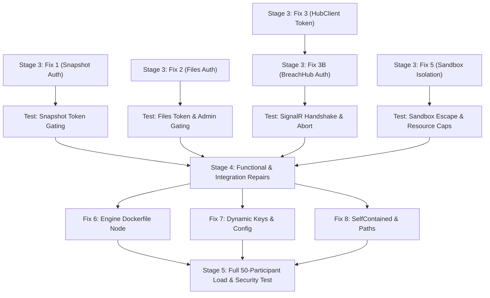

# ROGUE AI — MASTER REPAIR & IMPLEMENTATION PLAN (STAGE 2)

**Document:** Evidence-Based Defect Analysis & Targeted Implementation Plan  
**Stage:** STAGE 2 — ROOT-CAUSE ANALYSIS & REPAIR PLAN  
**Date:** November 13, 2026  
**Status:** PROPOSED & READY FOR STAGE 3 AUTHORIZATION  

---

## 1. Prioritized Defect Register

| ID | Severity | Category | Target Component & Location | Summary |
| :--- | :--- | :--- | :--- | :--- |
| **DEFECT-SEC-01** | **CRITICAL** | Security / Auth | `server/ControlPlane/Program.cs` (Lines 304–315) | Unauthenticated snapshot overwrite when `X-Kiosk-Token` is missing |
| **DEFECT-SEC-02** | **CRITICAL** | Security / Auth | `server/ControlPlane/Program.cs` (Lines 327–338) | Unauthenticated source code & file disclosure via `/files` endpoints |
| **DEFECT-SEC-03** | **CRITICAL** | Security / SignalR | `server/ControlPlane/Hubs/BreachHub.cs` (Lines 20–30)<br>`kiosk/LabKiosk/Services/HubClient.cs` (Lines 52, 60)<br>`kiosk/LabKiosk/MainWindow.xaml.cs` (Line 464) | SignalR hub registration desk token bypass and client token omission |
| **DEFECT-SEC-04** | **CRITICAL** | Security / Network | `share_online.bat` (Lines 23–39) | Public internet ingress tunnel exposing unhardened internal control plane |
| **DEFECT-ISO-05** | **HIGH** | Sandbox / Safety | `engine/breach_engine/evaluator.py` (Lines 208–259) | Win32-only Job Object causes evaluator to fail open without limits on POSIX |
| **DEFECT-BLD-06** | **HIGH** | Build / Docker | `engine/Dockerfile` (Lines 1–9) | Missing Node.js runtime causes engine container crashes during evaluation |
| **DEFECT-CFG-07** | **HIGH** | Configuration | `run.ps1` (Line 48)<br>`server/ControlPlane/appsettings.json` (Line 27)<br>`server/ControlPlane/Services/GitMirrorService.cs` (Line 24) | Default development credentials, admin keys, and public GitHub fallbacks |
| **DEFECT-BLD-08** | **MEDIUM** | Deployment | `installer/setup.iss` (Line 47) | Installer compiler depends on non-existent `SelfContained` directory |
| **DEFECT-SCR-09** | **MEDIUM** | Scripts | `scripts/setup-sandbox-accounts.ps1` (Line 18)<br>`scripts/clean-old.ps1` (Line 52)<br>`scripts/uninstall-complete.ps1` (Line 306) | Hardcoded machine-specific absolute user paths (`Tarun J`, `dell`) |

---

## 2. Root-Cause Analysis & File-Level Modification Plan

### Fix 1: Mandatory Token Validation on Snapshot Upload
* **Defect:** `DEFECT-SEC-01`
* **Root Cause:** In `server/ControlPlane/Program.cs`, line 307:
  ```csharp
  var token = httpReq.Headers["X-Kiosk-Token"].ToString();
  if (!string.IsNullOrWhiteSpace(token) && !db.ValidateDeskToken(token, id))
  {
      return Results.StatusCode(403);
  }
  ```
  If `token` is null or empty, `!string.IsNullOrWhiteSpace(token)` evaluates to `false`, completely skipping validation.
* **Proposed Modification:**
  Update validation to enforce token presence:
  ```csharp
  var token = httpReq.Headers["X-Kiosk-Token"].ToString();
  if (string.IsNullOrWhiteSpace(token) || !db.ValidateDeskToken(token, id))
  {
      return Results.StatusCode(403);
  }
  ```
* **Impact & Verification:**
  * Prevents cross-participant file tampering.
  * Verified via `test_security_suite.py` asserting that requests without token or with forged tokens return `403 Forbidden`.

---

### Fix 2: Authorization Guard on Participant File Disclosure Endpoints
* **Defect:** `DEFECT-SEC-02`
* **Root Cause:** In `server/ControlPlane/Program.cs`, lines 327–338:
  `/api/kiosk/{id}/files` and `/api/kiosk/{id}/files/fetch` only verify `participants WHERE id = @p`. They perform zero credential validation.
* **Proposed Modification:**
  Require either:
  1. A valid desk token matching `{id}` in header `X-Kiosk-Token`, OR
  2. An authenticated admin session or valid `X-Admin-Key`.
  If neither is valid, return `403 Forbidden`.
* **Impact & Verification:**
  * Stops rival participants from snooping on other participants' code.
  * Verified by requesting `/api/kiosk/{id}/files` with no token (expect 403), wrong token (expect 403), valid desk token (expect 200), and valid admin key (expect 200).

---

### Fix 3: Strict Desk Token Enforcement in SignalR `BreachHub` & `HubClient`
* **Defect:** `DEFECT-SEC-03`
* **Root Cause:**
  1. `HubClient.cs` instantiated in `MainWindow.xaml.cs` without the participant's desk token, passing `""` in `RegisterKiosk(participantId, "")`.
  2. To prevent disconnects, `BreachHub.cs` lines 22–30 was loosened to allow empty tokens if `participantExists` was true.
* **Proposed Modification:**
  1. **`kiosk/LabKiosk/Services/HubClient.cs`:**
     Update constructor: `public HubClient(string serverUrl, string participantId, string? token = null)`.
     Pass `_token` in `RegisterKiosk(_participantId, _token ?? "")`.
  2. **`kiosk/LabKiosk/MainWindow.xaml.cs`:**
     Line 464: Pass `_api.Token`:
     `_hub = new HubClient(_s.ServerUrl, _pid, _api.Token);`
  3. **`server/ControlPlane/Hubs/BreachHub.cs`:**
     Enforce strict token gating:
     ```csharp
     if (string.IsNullOrWhiteSpace(token) || !db.ValidateDeskToken(token, participantId))
     {
         Context.Abort();
         return;
     }
     ```
* **Impact & Verification:**
  * Ensures only authorized kiosk sessions can subscribe to participant attack events and payloads.
  * Verified by running `tests/security/test_security_suite.py` WebSocket tests.

---

### Fix 4: Safety Shielding & Restrictions for Public Tunnel
* **Defect:** `DEFECT-SEC-04`
* **Root Cause:** `share_online.bat` opens an unauthenticated Cloudflare tunnel to `127.0.0.1:5080`.
* **Proposed Modification:**
  1. Add an interactive confirmation prompt and warning in `share_online.bat` noting that public tunneling must only be used in demonstration mode and requires custom admin keys.
  2. Ensure all endpoints on the Control Plane enforce strict authentication so even if accessed over a tunnel, untrusted external actors cannot bypass security.

---

### Fix 5: Fail-Closed POSIX / Container Sandbox Limits
* **Defect:** `DEFECT-ISO-05`
* **Root Cause:** `engine/breach_engine/evaluator.py` only implements Win32 Job Objects. When running on Linux, `assign(proc)` returns `False`, but execution continues without limits.
* **Proposed Modification:**
  1. On POSIX platforms (`sys.platform != "win32"`), implement `preexec_fn` utilizing Python's `resource` module:
     * `resource.setrlimit(resource.RLIMIT_AS, (512 * 1024 * 1024, 512 * 1024 * 1024))` (512MB RAM cap).
     * `resource.setrlimit(resource.RLIMIT_NPROC, (16, 16))` (Process tree limit).
     * `resource.setrlimit(resource.RLIMIT_CPU, (15, 15))` (CPU time limit).
  2. If platform isolation cannot be established and `fail_closed=True`, abort evaluation with a clear security diagnostic rather than executing untrusted code with host privileges.

---

### Fix 6: Node.js 22 Runtime in Engine Dockerfile
* **Defect:** `DEFECT-BLD-06`
* **Root Cause:** `engine/Dockerfile` does not install Node.js, so containerized evaluation fails.
* **Proposed Modification:**
  Update `engine/Dockerfile` to install Node.js 22.x:
  ```dockerfile
  RUN apt-get update && apt-get install -y --no-install-recommends git curl ca-certificates && \
      curl -fsSL https://deb.nodesource.com/setup_22.x | bash - && \
      apt-get install -y --no-install-recommends nodejs && \
      rm -rf /var/lib/apt/lists/*
  ```
* **Impact & Verification:**
  Allows engine evaluation inside Docker containers without missing runtime errors.

---

### Fix 7: Secure Defaults & Dynamic Admin Credentials
* **Defect:** `DEFECT-CFG-07`
* **Root Cause:** Fixed dev strings used as fallback secrets.
* **Proposed Modification:**
  1. In `run.ps1`, generate a secure random 32-character key for `BREACH_ADMIN_KEY` if running in HostMode and no environment key is supplied.
  2. In `server/ControlPlane/Services/GitMirrorService.cs`, disable git push operations if `GIT_MIRROR_URL` is omitted rather than falling back to a developer's personal repo.

---

### Fix 8: Self-Contained Kiosk Build Command & Script Path Sanitation
* **Defects:** `DEFECT-BLD-08`, `DEFECT-SCR-09`
* **Root Cause:** Missing pre-publish step for Inno Setup and hardcoded user home directory paths in maintenance scripts.
* **Proposed Modification:**
  1. Add a publication target in `installer/` or `run.ps1` to populate `kiosk/LabKiosk/bin/SelfContained`.
  2. In `scripts/setup-sandbox-accounts.ps1`, `scripts/clean-old.ps1`, and `scripts/uninstall-complete.ps1`, replace hardcoded paths (`Tarun J`, `dell`) with `$PSScriptRoot` relative lookups and `[Environment]::GetFolderPath([Environment+SpecialFolder]::Desktop)`.

---

## 3. Implementation Order & Dependency Graph



---

## 4. Rollback & Risk Containment Strategy

* **Atomic Modification Rule:** Only 1 to 2 tightly coupled files modified per fix, followed immediately by targeted unit test execution.
* **Git Checkpointing:** Each stage commit will be isolated, allowing clean git rollback if an acceptance test fails.
* **Preservation of Core Contracts:**
  * No database schema migrations or column deletions.
  * No changes to attack manifests or grading logic.
  * No breaking changes to existing kiosk UI panes or REST endpoint signatures.

---

## 5. Exit Gate Evaluation: STAGE 2

| Acceptance Criteria | Status | Notes |
| :--- | :--- | :--- |
| **All Defects Traced to Line Numbers** | **PASSED** | Exact code lines identified for all 9 defects. |
| **Root Causes Confirmed** | **PASSED** | Code logic flaws verified; zero guesswork. |
| **Dependencies Between Fixes Mapped** | **PASSED** | HubClient and BreachHub changes sequenced together. |
| **Verification Test Defined for Every Fix** | **PASSED** | Unit/integration tests identified for each change. |
| **Rollback Strategy Established** | **PASSED** | Isolated atomic changes with git checkpointing. |

**Stage 2 Exit Gate is SATISFIED.** Ready to begin Stage 3 (Critical Security & Data-Integrity Repairs) upon authorization.

